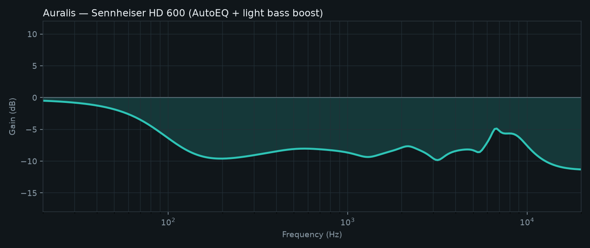

# Auralis — Headphone EQ Studio

Windows desktop app inspired by [Wavelet](https://github.com/Pittvandewitt/wavelet): pick a headphone, apply **AutoEQ** correction, tweak a graphic EQ / bass boost, preview the frequency response, and export a config for **Equalizer APO** (system-wide playback EQ).

Built as a portfolio project — demoable, documented, and easy to discuss in interviews.




## Features

| Feature | Description |
|--------|-------------|
| **15+ AutoEQ presets** | Popular OE / IEM profiles (oratory1990 via AutoEq) |
| **Import** | Load any AutoEQ `* ParametricEQ.txt` |
| **Graphic EQ** | 10-band overlay on top of AutoEQ |
| **Bass boost** | Low-shelf enhancement |
| **Auto preamp** | Suggests negative preamp to reduce clipping risk |
| **Response plot** | Live combined frequency-response curve + peak readout |
| **Spectrum preview** | EQ-shaped visualizer for demos |
| **Equalizer APO export** | File export + **Copy APO** to clipboard |
| **Profiles** | Save / load headphone + EQ settings as JSON |
| **First-run help** | Welcome guide + F1 help |

## Quick start

```powershell
cd auralis
python -m pip install -r requirements.txt
python main.py
```

Optional editable install:

```powershell
python -m pip install -e .
auralis
```

### Refresh / expand presets

```powershell
python scripts/fetch_presets.py
```

### System-wide audio (optional)

1. Install [Equalizer APO](https://sourceforge.net/projects/equalizerapo/)
2. In Auralis → **Export Equalizer APO** (or **Copy APO**)
3. `Include` the exported file from Equalizer APO’s `config.txt`
4. Refresh APO / restart the audio host

Without Equalizer APO you can still design curves, save profiles, and demo the UI.

### Optional Windows `.exe`

```powershell
powershell -ExecutionPolicy Bypass -File scripts/build_exe.ps1
# → dist\Auralis\Auralis.exe
```

## Architecture

```
src/auralis/
  autoeq/     # ParametricEQ parser + local preset catalog
  dsp/        # Biquad math + FR curve assembly
  apo/        # Equalizer APO config writer
  ui/         # CustomTkinter studio UI + Matplotlib plots
data/presets/ # Bundled AutoEQ text presets
scripts/      # Fetch presets, README assets, PyInstaller build
```

**Pipeline:** AutoEQ filters → graphic bands → bass shelf → auto preamp → plot / APO export.

## Resume / interview talking points

- Integrated the open **AutoEQ** parametric-filter format (parse, catalog, import, fetch script)
- Implemented **RBJ biquad** magnitude response for real frequency-response visualization
- Built a **desktop audio utility** (CustomTkinter + Matplotlib) with profiles and first-run UX
- Bridged app UX to **system-wide Windows EQ** via Equalizer APO config generation
- Packaged as a clean Python project (`src/` layout, tests, MIT license, optional `.exe` build)

## Tests

```powershell
python -m pip install pytest
$env:PYTHONPATH = "src"
python -m pytest -q
```

Regenerate the README curve image:

```powershell
$env:PYTHONPATH = "src"
python scripts/generate_readme_assets.py
```

## Credits

- Preset math / measurements ecosystem: [AutoEq](https://github.com/jaakkopasanen/AutoEq) by Jaakko Pasanen  
- Bundled demo presets: oratory1990 measurements via AutoEq results  
- UX inspiration: Wavelet (Android)

This project is independent and not affiliated with Wavelet or AutoEq.

## License

MIT — see [LICENSE](LICENSE). Bundled preset text files remain subject to their upstream AutoEq licensing.
